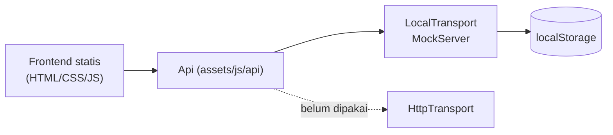

# Learnova LMS

Learnova adalah Learning Management System berbasis web. Saat ini project berada di **fase kuliah (final project)**: prototipe frontend vanilla HTML/CSS/JS sudah lengkap dan sedang dihubungkan ke backend Python FastAPI. Arah jangka panjang: platform kursus publik ala Udemy (siapa pun bisa membuat course atau belajar), dengan semua course **gratis** untuk fase ini.

> **Status:** frontend masih memakai mock data di `localStorage` (lewat `MockServer` di `assets/js/api/transport-local.js`). Backend FastAPI belum ada di `master`; rencananya ada di [docs/BACKEND_PLAN.md](docs/BACKEND_PLAN.md).

## Fitur

Legenda: ✅ terhubung ke backend · 🟡 masih mock (`localStorage`)

| Role | Fitur | Status |
|---|---|---|
| Admin | Dashboard (statistik, grafik, pending approvals, aktivitas) | 🟡 |
| Admin | Manajemen user (CRUD, aktif/nonaktif) | 🟡 |
| Admin | Approve / reject / archive / restore course | 🟡 |
| Admin | Laporan progress & nilai, cetak, export CSV | 🟡 |
| Instructor | Membuat & mengedit course, submit untuk approval | 🟡 |
| Instructor | Modul materi, quiz pilihan ganda, nilai akhir | 🟡 |
| Student | Browse & enroll course, belajar modul, progress | 🟡 |
| Student | Quiz dengan timer & review, nilai akhir, IPK, sertifikat | 🟡 |
| Semua | Login, profil, ganti password, tema terang/gelap | 🟡 |

Rincian fitur prototipe ada di [docs/FITUR.md](docs/FITUR.md).

## Tech stack

- **Frontend:** HTML5, CSS3, JavaScript murni (classic script, tanpa framework/bundler), Chart.js 4 (lokal di `assets/js/vendor/`).
- **Backend (direncanakan):** Python 3.12, FastAPI, SQLAlchemy 2.0, Alembic, Pydantic v2, PostgreSQL 16, pytest + httpx, ruff.
- **Test frontend:** `node --test` (unit test `domain.js` + kontrak MockServer).

## Arsitektur singkat

Kondisi saat ini:



## Struktur folder

```
LMS/
├── index.html              ← Login
├── pages/                  ← Halaman aplikasi per role
├── assets/
│   ├── css/style.css
│   ├── img/
│   └── js/
│       ├── domain.js       ← Logika murni (grade, IPK, progress, sertifikat)
│       ├── data.js         ← Mock data (seed)
│       ├── store.js        ← "Database" localStorage
│       ├── main.js         ← Guard, layout, UI helper
│       ├── api/            ← client, transport local/http, services
│       └── pages/          ← Script per halaman
├── tests/                  ← node --test
├── docs/                   ← Dokumen perancangan, keputusan, rencana backend
├── prompt.md               ← Instruksi kerja otonom untuk integrasi backend
├── CLAUDE.md               ← Konvensi repo untuk agen/kontributor
└── .github/workflows/      ← CI
```

## Menjalankan secara lokal

Prasyarat: browser modern. (Docker, Python, dan PostgreSQL baru dibutuhkan setelah backend ditambahkan.)

1. Clone repo: `git clone https://github.com/whoskavic/LMS.git && cd LMS`
2. Buka `index.html` langsung di browser, atau jalankan server statis: `npx http-server -p 5500` lalu buka `http://localhost:5500`.
3. Klik salah satu akun demo di halaman login.

Docker compose, migrasi Alembic, dan seed: belum tersedia.

## Environment variable

Belum ada (frontend murni statis).

## Akun demo

Mock data di browser:

| Role | Email | Password |
|---|---|---|
| Admin | admin@learnova.ac.id | admin123 |
| Instructor (Dosen) | budi@learnova.ac.id | dosen123 |
| Student (Mahasiswa) | alex@learnova.ac.id | student123 |

## API

Belum ada backend. Kontrak REST yang akan diikuti sudah didefinisikan oleh `MockServer` (`assets/js/api/transport-local.js`) dan dirangkum di [docs/BACKEND_PLAN.md](docs/BACKEND_PLAN.md).

## Database

Belum ada database server. Rencana skema PostgreSQL dan pemetaan dari mock data ada di [docs/BACKEND_PLAN.md](docs/BACKEND_PLAN.md); ERD lengkap akan ditulis di `docs/ERD.md` bersama migrasi pertama.

## Testing

```bash
node --test
```

## Deploy

Saat ini cukup sebagai static site (mis. Vercel: import repo, preset **Other**, tanpa build command). Langkah deploy backend + database akan ditambahkan setelah backend tersedia.

## Roadmap dan Known Issues

Roadmap integrasi backend (satu PR per fase):

1. Dokumentasi & rencana (PR ini)
2. Backend skeleton (FastAPI, Alembic, Docker, CI)
3. Auth & users
4. Courses & katalog publik
5. Enrollment & progress
6. Quiz dinilai di server
7. Nilai akhir, IPK, sertifikat, laporan, dashboard
8. Siap deploy

Known issues saat ini: data hanya tersimpan di browser, password mock disimpan sebagai teks biasa, kunci jawaban quiz ada di klien. Pertanyaan terbuka: [docs/OPEN_QUESTIONS.md](docs/OPEN_QUESTIONS.md).
