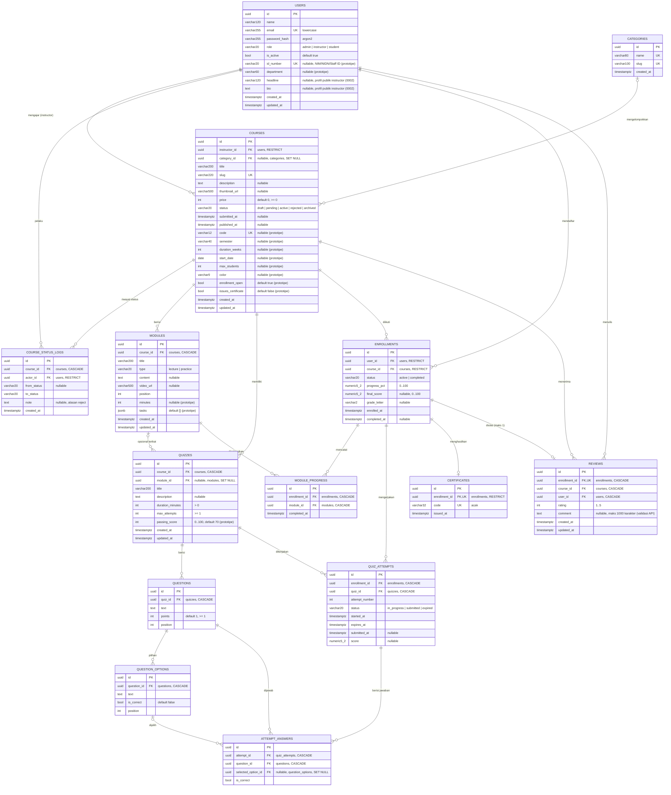

# ERD — Learnova LMS

Diagram ini mengikuti implementasi nyata di `backend/app/*/models.py` dan migrasi Alembic `backend/alembic/versions/`. Kolom bertanda *(prototipe)* adalah tambahan dari mock data (lihat [DECISIONS.md](DECISIONS.md) ADR-006).

Migrasi: `0001` (skema awal), `0002` (tabel `reviews`, kolom `users.headline` & `users.bio` — aditif, aman untuk data yang sudah ada).

## Relasi

- Satu **user** (role instructor) mengajar banyak **course**; user tidak bisa dihapus selama masih punya course (`RESTRICT`).
- **Category** opsional per course; menghapus kategori membuat `category_id` menjadi `NULL`.
- Setiap perubahan status course dicatat di **course_status_logs** (pelaku + catatan alasan reject).
- **Module** dan **quiz** milik course (`CASCADE`). Quiz boleh terikat ke modul tertentu (opsional).
- **Question** milik quiz; **question_options** milik question, tepat satu opsi benar per soal.
- **Enrollment** menghubungkan student dan course (unik per pasangan). Progress per modul di **module_progress**.
- **Quiz attempt** milik enrollment + quiz; jawaban per soal di **attempt_answers**.
- **Certificate** maksimal satu per enrollment; enrollment bersertifikat tidak bisa dihapus (`RESTRICT`).
- **Review** maksimal satu per enrollment (hanya learner yang terdaftar); ikut terhapus bila enrollment, course, atau user dihapus (`CASCADE`). `course_id` dan `user_id` disimpan agar agregat rating (rata-rata + jumlah) per course cukup satu query; agregat tidak disimpan di `courses`.

## Index & constraint

| Tabel | Index / constraint |
|---|---|
| users | `UNIQUE(email)`, partial `UNIQUE(id_number) WHERE id_number IS NOT NULL`, `CHECK role` |
| categories | `UNIQUE(name)`, `UNIQUE(slug)` |
| courses | `UNIQUE(slug)`, partial `UNIQUE(code) WHERE code IS NOT NULL`, `INDEX(status)`, `INDEX(category_id)`, `INDEX(instructor_id)`, GIN `pg_trgm` pada `title` dan `description`, `CHECK price >= 0`, `CHECK status` |
| course_status_logs | `INDEX(course_id, created_at)` |
| modules | `INDEX(course_id, position)`, `CHECK type` |
| quizzes | `INDEX(course_id)`, `CHECK duration_minutes > 0`, `CHECK max_attempts >= 1`, `CHECK passing_score 0..100` |
| questions | `INDEX(quiz_id, position)`, `CHECK points >= 1` |
| question_options | `INDEX(question_id, position)`, partial `UNIQUE(question_id) WHERE is_correct = true` |
| enrollments | `UNIQUE(user_id, course_id)`, `CHECK status`, `CHECK progress_pct 0..100`, `CHECK final_score 0..100` |
| module_progress | `UNIQUE(enrollment_id, module_id)` |
| quiz_attempts | `UNIQUE(enrollment_id, quiz_id, attempt_number)`, partial `UNIQUE(enrollment_id, quiz_id) WHERE status = 'in_progress'`, `CHECK status` |
| attempt_answers | `UNIQUE(attempt_id, question_id)` |
| certificates | `UNIQUE(enrollment_id)`, `UNIQUE(code)` |
| reviews | `UNIQUE(enrollment_id)`, `INDEX(course_id, created_at)`, `CHECK rating 1..5` |

Extension: `pg_trgm` (dibuat oleh migrasi `0001`).
