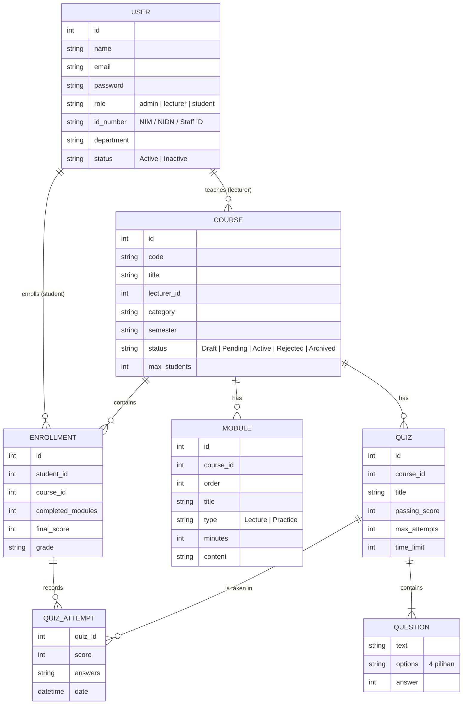

# 📘 PERANCANGAN ADMIN PANEL

## Learning Management System (LMS) — **Learnova**

---

## 🧠 1. Deskripsi Sistem

Learnova adalah Learning Management System (LMS) untuk mengelola proses pembelajaran secara digital. Sistem ini memiliki tiga jenis pengguna:

- **Admin (Operator)** → Mengelola akun pengguna, menyetujui course, dan memantau laporan
- **Dosen** → Membuat course sendiri, mengelola modul materi, quiz, dan nilai mahasiswa
- **Mahasiswa** → Mengikuti course, mempelajari modul, mengerjakan quiz, dan melihat nilai

Role ditentukan oleh akun yang login (tidak dipilih manual di halaman login).

---

## 🔐 2. Role & Hak Akses

### 👨‍💼 Admin (Operator)

- Mengelola data user: Mahasiswa, Dosen, dan Admin (CRUD, aktif/nonaktif)
- Menyetujui atau menolak course yang diajukan dosen (Pending → Active / Rejected)
- Mengarsipkan, memulihkan, dan menghapus course
- Melihat detail course (read-only), laporan progress, nilai quiz, dan aktivitas sistem

### 👩‍🏫 Dosen

- Membuat dan mengedit course miliknya sendiri (dikirim ke admin untuk disetujui)
- Mengelola modul materi: tambah, edit, urutkan, hapus
- Membuat dan mengedit quiz pilihan ganda
- Melihat progress & skor quiz mahasiswa, lalu mengisi nilai akhir

### 🎓 Mahasiswa

- Melihat daftar course yang diikuti per semester
- Mempelajari modul (video demo, materi, tugas latihan) dan menandai selesai
- Mengerjakan quiz dengan timer, melihat skor dan review jawaban
- Melihat nilai akhir dan IPK

### Semua role

- Profil: edit data diri, ganti password, pilih tema terang/gelap

---

## 📋 3. Struktur Menu (Sidebar Navigation)

### 🔹 Admin

- Dashboard
- Users (tab Mahasiswa · Dosen · Admin)
- Courses → Detail Course
- Reports
- Profile

### 🔹 Dosen

- Dashboard
- My Courses → Detail Course (tab Overview · Modules · Quizzes · Students & Grades)
- New Course
- Profile

### 🔹 Mahasiswa

- Dashboard → Course (modul & quiz) → Quiz
- Profile

---

## 🔄 4. User Flow

### Admin:

Login → Dashboard → lihat *Pending approvals* → Approve / Reject course → Users → tambah / edit / nonaktifkan akun → Reports → cetak atau export CSV

### Dosen:

Login → Dashboard → New Course → isi form → *Submit for approval* (status Pending) → setelah disetujui admin: Detail Course → tambah modul & quiz → pantau progress mahasiswa → isi nilai akhir → Save grades

### Mahasiswa:

Login → Dashboard → pilih course → buka modul → tonton video / kerjakan tugas → *Mark as complete* → kerjakan quiz → lihat skor & review → lihat nilai akhir dan IPK di dashboard

---

## 🗂️ 5. Entity Relationship Diagram (ERD)

---

## 🎨 6. Konsep UI/UX Design

Menggunakan **Material Design** agar:

- Clean & modern
- Mudah digunakan
- Konsisten antar halaman

### 🎨 Color Palette

| Token | Light | Dark |
|---|---|---|
| Primary | #4F46E5 | #6366F1 |
| Secondary / Success | #22C55E | #22C55E |
| Warning | #F59E0B | #F59E0B |
| Danger | #EF4444 | #EF4444 |
| Background | #F9FAFB | #0B1120 |
| Surface (card) | #FFFFFF | #111827 |
| Text Primary | #111827 | #F3F4F6 |
| Text Secondary | #6B7280 | #9CA3AF |

Semua warna didefinisikan sebagai CSS variable di `assets/css/style.css`, sehingga dark mode cukup mengganti nilai token.

### 🔤 Typography

- Font: Inter (fallback Poppins / system-ui)
- Heading: 18–28px (Bold)
- Body: 14–15px (Regular)

---

## 🧩 7. Komponen UI

- Sidebar Navigation (menu berbeda per role, off-canvas di mobile)
- Navbar / Header (search, tombol tema, notifikasi, avatar)
- Card (stat card, course card, panel)
- Table Data (sortir kolom, pagination, tampilan kartu di mobile)
- Form Input (validasi inline, switch, upload thumbnail)
- Button, Badge status, Progress bar
- Modal (konfirmasi & form), Toast notifikasi
- Tabs (Detail Course, Users)
- Quiz: pilihan jawaban, navigasi nomor soal, timer, cincin skor

---

## 📊 8. Dashboard

### 🔹 Dashboard Admin

- Total Course, Mahasiswa, Dosen, dan Pending approvals
- Grafik enrollment & completion (Chart.js)
- Daftar course menunggu persetujuan (Approve / Reject)
- Status sistem & aktivitas terbaru

### 🔹 Dashboard Dosen

- Jumlah course (per status), mahasiswa, rata-rata progress, rata-rata skor quiz
- Grafik progress & skor quiz per course
- Daftar course saya & percobaan quiz terbaru

### 🔹 Dashboard Mahasiswa

#### 🎯 Summary

- **Total Mata Kuliah yang Diikuti**
- **Progress Pembelajaran (%)**
- **Indeks Prestasi (IPK)** — dihitung dari nilai akhir yang diberikan dosen

#### 📚 Daftar Course

Menampilkan course dalam bentuk card (atau tabel):

- Nama Course, Nama Dosen, Progress
- Tombol **Continue course** / **View final grade**

---

## 📋 9. Halaman Data Master

### 📊 Tabel Course (Admin & Dosen)

| Course | Lecturer | Category | Students | Avg progress | Status | Aksi |
| --- | --- | --- | --- | --- | --- | --- |
| Web Programming | Dr. Budi Santoso | Technology | 11 / 60 | 46% | Active | View / Archive / Delete |
| Mobile Programming | Dr. Budi Santoso | Technology | 0 / 40 | 0% | Pending | View / Approve / Reject |

### 📊 Tabel User (Admin)

| User | NIM / NIDN | Department | Courses | Status | Aksi |
| --- | --- | --- | --- | --- | --- |
| Alex Mercer | 40992 | Informatics | 8 | Active | Edit / Nonaktifkan / Hapus |

---

## 📝 10. Halaman Form

- **Form Course (Dosen)** — tambah/edit course, validasi 8 field, kode course unik, draft atau kirim untuk persetujuan
- **Form User (Admin, modal)** — email & NIM/NIDN unik, format ID sesuai role, password awal
- **Form Modul (Dosen, modal)** — judul, tipe, durasi, isi materi, tugas latihan
- **Editor Quiz (Dosen, modal)** — soal pilihan ganda dengan 4 opsi dan kunci jawaban
- **Profil** — edit nama, ganti password dengan validasi

---

## 📊 11. Halaman Laporan

- Progress belajar mahasiswa per course
- Nilai quiz dan nilai akhir
- Status mahasiswa: On track / At risk / Completed
- Aktivitas sistem
- Cetak laporan dan export CSV

---

## 🖼️ 12. Wireframe & Prototype

### 🔗 Link Google Stitch

https://stitch.withgoogle.com/projects/2084241561943169256

### 🔗 Link Figma

https://www.figma.com/design/sSvCCmgGq4LCb3lFxY6iUG/Untitled?node-id=0-1&t=mIuwTX8JjGj3ImX8-1

---

### 📸 Screenshot Desain

Berikut merupakan hasil perancangan UI yang telah dibuat:

- Dashboard Admin
- Dashboard Mahasiswa
- Halaman Data Master (Table Course)
- Halaman Form Input Course

(Screenshot diambil dari hasil desain Figma)

Halaman tambahan pada tahap implementasi (Login, Users, Dashboard Dosen, Detail Course, Quiz, Profil, Laporan) dikembangkan dari design system yang sama.

---

### 🧱 Penjelasan Proses Desain

Perancangan UI dilakukan melalui beberapa tahapan:

1. **Wireframe (Google Stitch)**
   - Membuat struktur dasar layout (sidebar, header, content)
   - Menentukan posisi komponen seperti card, tabel, dan form
   - Menggunakan pendekatan low-fidelity

2. **Refinement (Figma)**
   - Mengubah wireframe menjadi high-fidelity design
   - Menambahkan warna sesuai design system
   - Mengatur typography dan spacing
   - Menambahkan komponen UI seperti:
     - Card dashboard
     - Button
     - Progress bar
     - Table
     - Form input

3. **Implementasi (HTML, CSS, JavaScript)**
   - Slicing desain Figma menjadi template `pages/layout.html` (Milestone 2)
   - Membangun halaman per role dan interaktivitas JavaScript (Milestone 3)

---

### 🎨 Implementasi Design System

Desain pada Figma telah menerapkan:

- Material Design
- Color Palette:
  - Primary (Indigo)
  - Success (Green)
  - Danger (Red)
- Typography: Inter / Poppins
- Layout berbasis card dan grid
- Responsive structure
- Mode terang & gelap (ditambahkan saat implementasi)

---

## ⚙️ 13. Tools

- Figma
- Stitch Google
- HTML5, CSS3, JavaScript (tanpa framework)
- Chart.js (disimpan lokal di `assets/js/vendor/`)

---

## ✅ 14. Catatan

- Sistem menggunakan **mock data** yang disimpan di `localStorage` browser
- Tidak terhubung backend
- Fokus pada UI/UX & interaktivitas
- Rekap lengkap fitur, akun demo, dan cara menjalankan: lihat [FITUR.md](FITUR.md)

---
