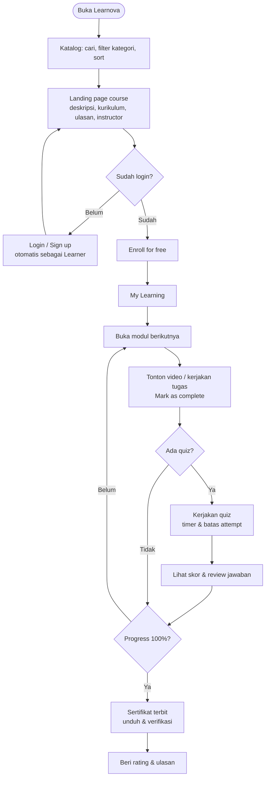
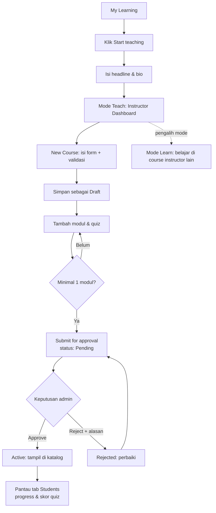
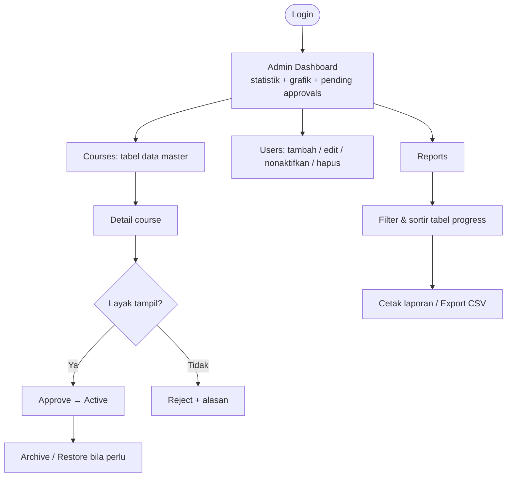
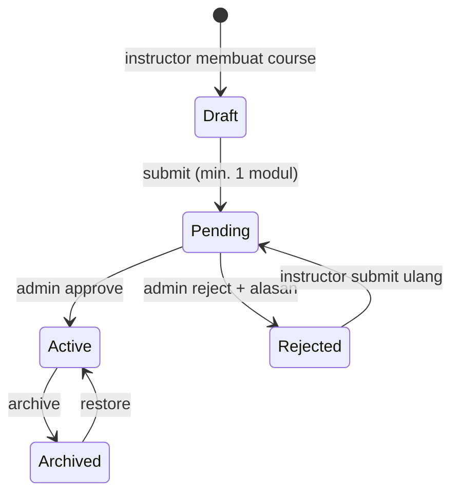
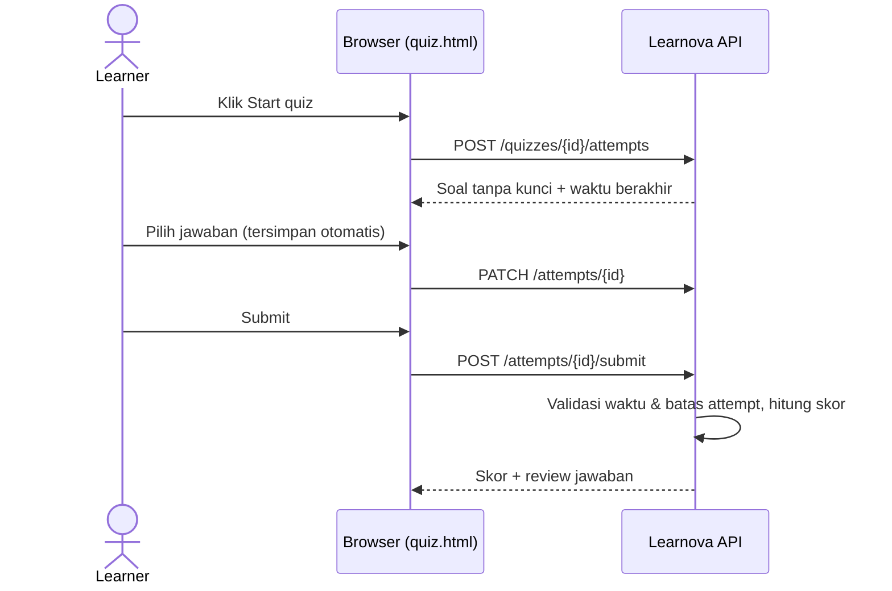
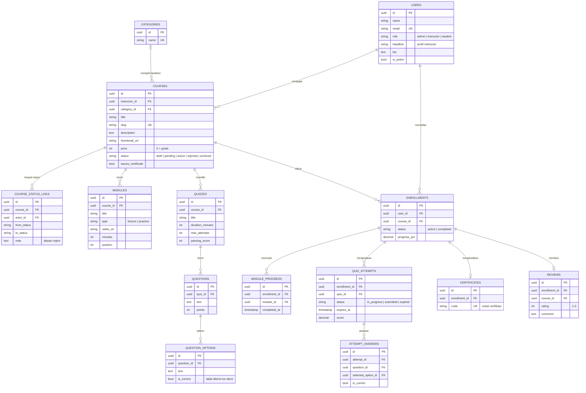

# 📘 PERANCANGAN — Learnova

Platform kursus online gratis ala Udemy, dengan Admin Panel untuk mengelola platform.

| | |
|---|---|
| **Mata kuliah** | Pemrograman Web 2 (Client-Side Programming) |
| **Topik** | Learning Management System (LMS — Platform Pembelajaran) |
| **Tema visual** | Material Design |
| **Demo** | https://lms-kavic.vercel.app |
| **Repository** | https://github.com/whoskavic/lms |

---

## 🧠 1. Deskripsi Sistem

**Learnova** adalah platform kursus online tempat **siapa pun bisa belajar dan siapa pun bisa mengajar**. Semua course gratis. Pengunjung bisa menjelajah katalog tanpa login, mendaftar sebagai *learner* untuk mengikuti course, lalu dengan satu klik ("Start teaching") menjadi *instructor* yang membuat course sendiri.

Agar kualitas katalog terjaga, setiap course yang diajukan instructor harus disetujui **Admin** terlebih dahulu sebelum tampil di katalog publik. Admin mengelola platform melalui **Admin Panel**, yang menjadi fokus utama tugas ini: dashboard dengan grafik, data master dengan CRUD, form dengan validasi, dan laporan.

### Masalah yang diselesaikan

| Pengguna | Masalah | Solusi di Learnova |
|---|---|---|
| Learner | Sulit menemukan materi belajar terstruktur yang gratis | Katalog dengan pencarian, kategori, rating, dan progress belajar |
| Instructor | Butuh tempat membagikan materi tanpa membangun website sendiri | Course builder: modul, video, quiz, sertifikat |
| Admin | Harus menjaga kualitas konten dan memantau aktivitas platform | Alur persetujuan course, manajemen user, dan laporan |

---

## 🔐 2. Role & Hak Akses

Role ditentukan oleh akun yang login, tidak dipilih manual. Semua pendaftar baru otomatis menjadi **Learner**.

### 👨‍💼 Admin (Operator platform)

- Mengelola data user: tambah, edit, aktif/nonaktif, hapus (dengan aturan bisnis)
- Meninjau course: **Approve**, **Reject** (wajib alasan), Archive, Restore, dan melihat riwayat status
- Melihat laporan platform, mencetak, dan export CSV
- Menghapus ulasan yang tidak pantas
- Melihat katalog dari dalam aplikasi

### 👩‍🏫 Instructor

- Menjadi instructor lewat tombol **Start teaching** (mengisi headline dan bio)
- Membuat dan mengedit course miliknya sendiri, lalu mengajukannya ke admin (minimal 1 modul)
- Mengelola modul (Lecture/Practice, video URL, urutan) dan quiz pilihan ganda
- Memantau peserta (read-only): progress, skor quiz terbaik, status selesai
- **Tetap bisa belajar** di course instructor lain, lewat pengalih mode **Learn / Teach**

### 🎓 Learner

- Menjelajah katalog, membaca landing page course, dan enroll gratis
- Mempelajari modul secara berurutan dan menandai selesai
- Mengerjakan quiz dengan timer dan batas percobaan, lalu melihat skor dan review jawaban
- Mendapat sertifikat saat progress 100% (bisa diverifikasi publik)
- Memberi rating dan ulasan (satu per course)

### 🌐 Pengunjung (tanpa login)

- Melihat katalog, landing page course, ulasan, dan profil instructor
- Memverifikasi keaslian sertifikat

### Semua role yang login

- Profil: edit nama, ganti password, tema terang/gelap

---

## 📋 3. Struktur Menu (Sidebar Navigation)

### 🔹 Admin

```
Admin Panel
├── Dashboard            (pages/dashboard.html)
├── Users                (pages/users.html)
├── Courses              (pages/data-master.html)
│   └── Detail Course    (pages/course-detail.html — read-only + approval)
├── Reports              (pages/laporan.html)
├── Catalog              (pages/browse.html)
└── Profile              (pages/profile.html)
```

### 🔹 Instructor — mode Teach

```
Instructor
├── Dashboard            (pages/lecturer-dashboard.html)
├── My Courses           (pages/data-master.html)
│   └── Detail Course    (pages/course-detail.html)
│       ├── Overview
│       ├── Modules
│       ├── Quizzes
│       └── Students     (read-only)
├── New Course           (pages/form.html)
├── Profile              (pages/profile.html)
└── [Learn | Teach]      (pengalih mode)
```

### 🔹 Learner (dan Instructor mode Learn)

```
Learner
├── My Learning          (pages/student-dashboard.html)
│   └── Course           (pages/course.html — modul & quiz)
│       └── Quiz         (pages/quiz.html)
├── Browse courses       (pages/browse.html)
│   ├── Landing page     (?course=…)
│   └── Profil instructor (?instructor=…)
└── Profile              (pages/profile.html)
```

### 🔹 Halaman publik (tanpa sidebar)

```
Publik
├── Login                (index.html)
├── Sign up              (register.html)
├── Katalog              (catalog.html)
│   └── Landing page     (catalog.html?course=…)
├── Profil instructor    (instructor.html?id=…)
└── Verifikasi sertifikat (verify.html)
```

Pengunjung yang sudah login dan membuka halaman katalog publik otomatis diarahkan ke versi di dalam aplikasi (`pages/browse.html`), sehingga sidebar tetap konsisten.

---

## 🔄 4. User Flow

### 4.1 Pengunjung → Learner



### 4.2 Learner → Instructor



### 4.3 Admin



### 4.4 Siklus status course



### 4.5 Alur pengerjaan quiz (penilaian di server)

Kunci jawaban tidak pernah dikirim ke browser sebelum quiz di-submit, sehingga tidak bisa dicontek lewat DevTools.



---

## 🗂️ 5. Entity Relationship Diagram (ERD)

ERD konseptual berikut menampilkan entitas dan atribut utama. Skema lengkap (tipe data, constraint, index) ada di [ERD.md](ERD.md).



### Relasi penting

- Satu **user** bisa mengajar banyak **course** (sebagai instructor) sekaligus mengikuti banyak course lain (sebagai learner) lewat **enrollment**.
- **Enrollment** menjadi pusat aktivitas belajar: progress modul, percobaan quiz, sertifikat, dan ulasan semuanya terikat ke enrollment. Hanya user yang sudah enroll yang bisa mengerjakan quiz atau memberi ulasan.
- **Course status log** mencatat setiap perpindahan status beserta pelaku dan alasannya, sehingga alur approval bisa diaudit.
- Satu enrollment maksimal punya **satu sertifikat** dan **satu ulasan**.

---

## 🎨 6. Konsep UI/UX Design

Menggunakan **Material Design**: permukaan berbasis *card* dengan bayangan lembut, hierarki tipografi yang jelas, warna primer yang konsisten, dan umpan balik visual pada setiap aksi (toast, state loading, state kosong).

### Prinsip

- **Catalog-first, seperti Udemy.** Pengunjung langsung bisa menjelajah course tanpa login.
- **Satu akun, dua peran.** Pengalih mode Learn / Teach, tanpa perlu akun terpisah.
- **Konsisten antar halaman.** Satu layout (sidebar, header, area konten) dipakai di semua halaman aplikasi.
- **Mobile-first.** Sidebar menjadi *off-canvas*, dan tabel berubah menjadi tampilan kartu di layar kecil.
- **Setiap data punya tiga state:** loading (skeleton), kosong (dengan ajakan bertindak), dan error (dengan tombol coba lagi).

### 🎨 Color Palette

| Token | Light | Dark | Kegunaan |
|---|---|---|---|
| Primary | #4F46E5 | #6366F1 | Tombol utama, link, menu aktif |
| Success | #22C55E | #22C55E | Progress, status Active, label Free |
| Warning | #F59E0B | #F59E0B | Status Pending, bintang rating |
| Danger | #EF4444 | #EF4444 | Hapus, Reject, error |
| Background | #F9FAFB | #0B1120 | Latar halaman |
| Surface (card) | #FFFFFF | #111827 | Card, tabel, modal |
| Text Primary | #111827 | #F3F4F6 | Judul dan isi |
| Text Secondary | #6B7280 | #9CA3AF | Keterangan |

Semua warna didefinisikan sebagai CSS variable di `assets/css/style.css`, sehingga dark mode cukup mengganti nilai token.

### 🔤 Typography

- Font: **Inter** (fallback system-ui)
- Heading: 18–28px, Bold
- Body: 14–15px, Regular
- Label/caption: 12–13px, Medium

---

## 🧩 7. Komponen UI

| Komponen | Dipakai di |
|---|---|
| Sidebar navigation (menu per role, pengalih Learn/Teach, off-canvas di mobile) | Semua halaman aplikasi |
| Header (search, tombol tema, notifikasi, avatar) | Semua halaman aplikasi |
| Stat card | Dashboard admin, instructor, My Learning, laporan |
| Course card (thumbnail, instructor, rating, learner, modul + durasi, label Free) | Katalog, My Learning |
| Data table (search, filter, sortir, pagination, tampilan kartu di mobile) | Users, Courses, Students, Laporan |
| Form input (validasi inline, switch, preview thumbnail) | Form course, form user, modul, profil |
| Modal (konfirmasi hapus, form, alasan reject) | Data master, users, detail course |
| Toast notifikasi | Semua aksi simpan/hapus/error |
| Tabs | Detail course, My Learning |
| Accordion kurikulum (ikon kunci sebelum enroll) | Landing page course |
| Rating bintang + distribusi rating | Katalog, landing page, profil instructor |
| Badge status dan progress bar | Tabel course, kartu course |
| Komponen quiz (navigasi nomor soal, timer, cincin skor) | Halaman quiz |
| Grafik Chart.js | Dashboard admin, dashboard instructor, laporan |

---

## 📊 8. Dashboard

### 🔹 Dashboard Admin

- Stat card: **Total courses**, **Learners**, **Instructors**, **Pending approvals**
- Grafik **enrollment & completion 6 bulan terakhir** (Chart.js)
- Daftar course menunggu persetujuan dengan aksi Approve / Reject
- Status sistem dan aktivitas terbaru

### 🔹 Dashboard Instructor

- Stat card: **My courses**, **Learners**, **Average progress**, **Average quiz score**
- Grafik progress dan skor quiz per course (Chart.js)
- Daftar course saya dan percobaan quiz terbaru

### 🔹 My Learning (Learner)

- Stat card: **In progress**, **Completed**, **Certificates**
- Tab: Sedang dipelajari · Selesai · Sertifikat
- Kartu course dengan progress dan tombol **Continue learning** ke modul berikutnya
- Tombol **Start teaching** untuk menjadi instructor

---

## 📋 9. Halaman Data Master

### 📊 Tabel Course (Admin & Instructor) — `pages/data-master.html`

Filter: pencarian, kategori, status, instructor (admin).

| Course name | Instructor | Category | Learners | Avg progress | Status | Actions |
|---|---|---|---|---|---|---|
| Foundations of Data Science | Dr. Budi Santoso | Technology | 2 | 46% | Active | View / Archive |
| Mobile Programming | Dr. Budi Santoso | Technology | 0 | 0% | Pending | View / Approve / Reject |
| Course baru saya | (instructor) | Design | 0 | 0% | Draft | Edit / Delete |

Aturan hapus: course hanya bisa dihapus permanen bila masih Draft dan belum punya peserta; selain itu gunakan Archive.

### 📊 Tabel User (Admin) — `pages/users.html`

| User | Courses | Status | Actions |
|---|---|---|---|
| Alex Mercer · alex@learnova.ac.id · Learner | 8 | Active | Edit / Deactivate / Delete |

Aturan hapus: user yang sudah punya course atau enrollment tidak dihapus permanen, cukup dinonaktifkan.

---

## 📝 10. Halaman Form

- **Form Course** (`pages/form.html`): judul (5–100 karakter), deskripsi (20–500 karakter), kategori, thumbnail URL dengan preview, dan opsi sertifikat. Bisa disimpan sebagai Draft atau langsung diajukan. Course tanpa modul tetap tersimpan sebagai Draft dan instructor diarahkan untuk menambah modul.
- **Form User** (modal, admin): nama, email unik, role, status, dan password awal.
- **Form Modul** (modal, instructor): judul, tipe Lecture/Practice, durasi, isi materi, video URL, dan tugas latihan.
- **Editor Quiz** (modal, instructor): soal pilihan ganda dengan tepat satu jawaban benar, durasi, batas attempt, dan nilai lulus.
- **Form Ulasan** (landing page, learner): rating 1–5 dan komentar opsional.
- **Profil**: edit nama, headline dan bio (instructor), ganti password.

Semua form divalidasi dengan JavaScript sebelum dikirim (pesan error per field), lalu divalidasi ulang di server.

---

## 📊 11. Halaman Laporan — `pages/laporan.html`

- Stat card: Learners, Instructors, Enrollments, Average progress, Average quiz score, Completion rate
- Grafik: course per kategori, rata-rata skor quiz per course, dan course terpopuler
- Tabel progress learner: Learner, Course, Progress, Avg quiz, Status (On track / At risk / Completed), dengan filter, sortir, dan pagination
- Aktivitas sistem terbaru
- **Cetak laporan** dan **Export CSV**

---

## 🖼️ 12. Wireframe & Prototype

### 🔗 Link Google Stitch

https://stitch.withgoogle.com/projects/2084241561943169256

### 🔗 Link Figma

https://www.figma.com/design/sSvCCmgGq4LCb3lFxY6iUG/Untitled?node-id=0-1&t=mIuwTX8JjGj3ImX8-1

### 📸 Screenshot Desain

| Halaman | Rancangan |
|---|---|
| Dashboard Admin |  |
| Data Master (Tabel Course) |  |
| Form Input Course |  |
| Dashboard Learner |  |

### 🧱 Proses Desain

1. **Wireframe (Google Stitch).** Menyusun struktur dasar layout (sidebar, header, area konten), posisi card, tabel, dan form, dengan pendekatan low-fidelity.
2. **Refinement (Figma).** Mengubah wireframe menjadi desain high-fidelity: menerapkan color palette, typography, spacing, dan komponen reusable (button, form input, card, table, progress bar).
3. **Implementasi (HTML, CSS, JavaScript).** Slicing desain Figma menjadi template `pages/layout.html` (Milestone 2), lalu membangun halaman per role beserta interaktivitas JavaScript (Milestone 3).
4. **Evolusi produk.** Setelah Milestone 3, konsep dikembangkan dari LMS kampus menjadi platform kursus publik ala Udemy. Halaman katalog, landing page course, My Learning, ulasan, dan profil instructor dibangun dari design system yang sama. Konsep akademik (IPK, semester, NIM) dihapus karena tidak relevan untuk platform publik.

---

## ✅ 13. Pemetaan ke Kriteria Tugas

| Kriteria | Implementasi di Learnova |
|---|---|
| Halaman login | `index.html` |
| Template layout | `pages/layout.html` (sidebar, header, content, footer) |
| Dashboard + Chart.js | `pages/dashboard.html`, juga dashboard instructor dan laporan |
| Data tabel (Tambah, Edit, Hapus) | `pages/data-master.html`, `pages/users.html` |
| Form + validasi JavaScript | `pages/form.html`, modal user, modul, quiz, profil |
| Laporan / cetak | `pages/laporan.html` (cetak + export CSV) |
| Interaktivitas | Toggle sidebar, modal konfirmasi hapus, validasi form, tabs, accordion, timer quiz, dark mode |
| Responsif | Grid/flexbox, sidebar off-canvas, tabel menjadi kartu di mobile |
| Tema visual | Material Design |

---

## ⚙️ 14. Tools & Teknologi

- **Desain:** Google Stitch, Figma
- **Frontend:** HTML5, CSS3, JavaScript (tanpa framework), Chart.js (disimpan lokal di `assets/js/vendor/`)
- **Backend (nilai tambah):** Python FastAPI, PostgreSQL, autentikasi JWT
- **Hosting:** Vercel (frontend dan API) dengan database Neon Postgres

---

## 📌 15. Catatan

- Fokus tugas tetap pada sisi client: struktur informasi, navigasi, desain UI, dan pengalaman pengguna.
- Data kini tersimpan di database melalui API, menggantikan mock data `localStorage` pada tahap awal. Penilaian quiz dilakukan di server agar kunci jawaban tidak bisa dilihat dari browser.
- Akun demo, cara menjalankan, dan daftar fitur lengkap: lihat [README.md](../README.md). Keputusan desain: [DECISIONS.md](DECISIONS.md).
