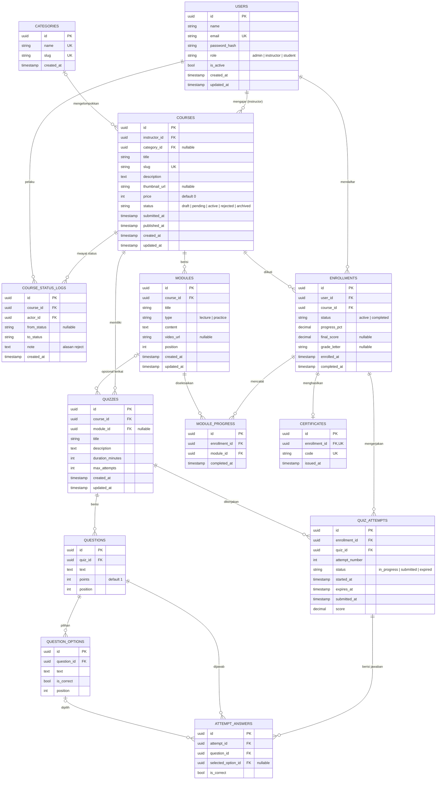

# Misi
Kamu bekerja secara otonom di repo Learnova LMS. Tugasmu: menambahkan backend Python FastAPI dan menghubungkan frontend vanilla JS yang sudah ada ke backend tersebut, sampai aplikasi siap di-deploy dan diuji dosen untuk final project kuliah. Kerjakan dari awal sampai akhir: branch, commit, push, buka PR, tunggu CI hijau, lalu merge. Jangan berhenti untuk bertanya kecuali ada kondisi STOP (lihat bagian "Kondisi STOP").

# Konteks produk
- Learnova sedang diarahkan menjadi platform kursus publik ala Udemy (siapa pun bisa membuat course atau belajar). Untuk fase kuliah ini, scope dibatasi.
- Semua course GRATIS. Tidak ada payment.
- Prioritas utama: instructor bisa menambah course, user bisa search course, user bisa enroll dan belajar dengan progress.
- Frontend TETAP vanilla HTML/CSS/JS + Chart.js. JANGAN migrasi ke React/Next.js atau framework lain.
- Saat ini data masih mock di localStorage. Target akhirnya: semua data berasal dari API.

# Langkah 0: Pahami repo dulu
1. Baca PERANCANGAN.md, FITUR.md, README.md (jika ada), dan seluruh struktur frontend, terutama modul yang membaca/menulis localStorage.
2. Petakan entitas yang sudah ada: User, Course, Module, Quiz, Question, Enrollment, QuizAttempt, beserta field-nya di mock data.
3. Cocokkan hasil pemetaan dengan bagian "Skema Database" di bawah sebelum menulis model.
4. JANGAN mengarang fitur yang tidak ada di dokumen atau kode, kecuali yang diizinkan eksplisit di prompt ini.

# Keputusan arsitektur (wajib diikuti)
- Backend di folder baru `backend/`. Jangan pindahkan file frontend kecuali benar-benar perlu dan tidak merusak path.
- Stack: Python 3.12, FastAPI, SQLAlchemy 2.0, Alembic, Pydantic v2, PostgreSQL 16, pytest + httpx, ruff.
- Struktur modular monolith, satu folder per domain: auth, users, courses, enrollments, quizzes, reports. Pisahkan router, schema, model, dan service.
- Auth: JWT di header Authorization (frontend menyimpan token di localStorage, cukup untuk fase ini). Password di-hash dengan argon2 atau bcrypt. Secret dari environment variable.
- Role tetap tiga agar UI dan dashboard yang ada tidak rusak: admin, instructor (dulu "Dosen"), student (dulu "Mahasiswa"). Self-registration publik boleh memilih student atau instructor. Admin hanya dibuat lewat seed.
- Ubah label UI "Dosen" menjadi "Instructor" dan "Mahasiswa" menjadi "Student" HANYA jika perubahannya kecil; jika berisiko, biarkan dan catat di docs/OPEN_QUESTIONS.md.
- Pertahankan alur status course: Draft → Pending → Active / Rejected / Archived. Transisi divalidasi di server berdasarkan role (instructor pemilik course melakukan submit, admin melakukan approve/reject).
- Hanya course berstatus active yang tampil di katalog publik dan bisa di-enroll.
- Search: endpoint katalog dengan query `q` (cari di title dan description, case-insensitive), filter category, dan pagination.
- Quiz WAJIB dinilai di server: kunci jawaban tidak pernah dikirim ke client sebelum submit; skor dihitung server; batas attempt dan timer divalidasi di server.
- Materi video cukup berupa URL (misalnya embed YouTube). JANGAN membangun upload/transcoding video.
- Frontend: buat satu modul `api.js` (base URL dari config, fetch wrapper, token, error handling). Ganti akses localStorage modul per modul. Setiap halaman yang diubah harus menangani state loading, empty, dan error.
- CORS diatur dari environment variable.

# Skema Database (WAJIB diikuti)
Skema ini adalah sumber kebenaran untuk model SQLAlchemy dan migrasi Alembic. Sebelum mengimplementasikan, cocokkan dengan mock data di prototipe:
- Jika prototipe punya field yang TIDAK ada di skema ini (misalnya SKS/credit untuk perhitungan IPK, atau passing score quiz), TAMBAHKAN field tersebut. Jangan buang data prototipe.
- Jika relasi di prototipe berbeda (misalnya quiz terikat ke course, bukan ke module), ikuti prototipe dan catat perbedaannya di docs/DECISIONS.md.
- Jangan menambah tabel atau kolom di luar skema ini kecuali untuk alasan di dua poin di atas.

## Konvensi umum
- Primary key: UUID (uuid4) untuk semua tabel.
- Semua tabel punya created_at; tabel yang bisa diedit punya updated_at (timezone-aware, UTC).
- Enum disimpan sebagai string dengan CHECK constraint (bukan native PG enum), supaya migrasi lebih mudah.
- Aktifkan extension pg_trgm lewat migrasi Alembic.

## ERD referensi

## Detail tabel
1. users: id, name varchar(120) not null, email varchar(255) not null unique (disimpan lowercase), password_hash not null, role ('admin','instructor','student') not null, is_active bool default true, created_at, updated_at.
2. categories: id, name varchar(80) unique, slug varchar(100) unique, created_at.
3. courses: id, instructor_id FK users ON DELETE RESTRICT, category_id FK categories ON DELETE SET NULL nullable, title varchar(200) not null, slug varchar(220) unique, description text, thumbnail_url nullable, price int not null default 0 CHECK (price >= 0), status ('draft','pending','active','rejected','archived') default 'draft', submitted_at nullable, published_at nullable, created_at, updated_at.
4. course_status_logs: id, course_id FK courses ON DELETE CASCADE, actor_id FK users ON DELETE RESTRICT, from_status nullable, to_status not null, note text nullable, created_at.
5. modules: id, course_id FK courses ON DELETE CASCADE, title varchar(200), type ('lecture','practice'), content text nullable, video_url nullable, position int not null, created_at, updated_at.
6. quizzes: id, course_id FK courses ON DELETE CASCADE, module_id FK modules ON DELETE SET NULL nullable, title, description nullable, duration_minutes int CHECK (> 0), max_attempts int CHECK (>= 1), created_at, updated_at.
7. questions: id, quiz_id FK quizzes ON DELETE CASCADE, text text not null, points int default 1 CHECK (>= 1), position int.
8. question_options: id, question_id FK questions ON DELETE CASCADE, text text not null, is_correct bool default false, position int.
9. enrollments: id, user_id FK users ON DELETE RESTRICT, course_id FK courses ON DELETE RESTRICT, status ('active','completed') default 'active', progress_pct numeric(5,2) default 0 CHECK (0..100), final_score numeric(5,2) nullable CHECK (0..100), grade_letter varchar(2) nullable, enrolled_at, completed_at nullable.
10. module_progress: id, enrollment_id FK enrollments ON DELETE CASCADE, module_id FK modules ON DELETE CASCADE, completed_at.
11. quiz_attempts: id, enrollment_id FK enrollments ON DELETE CASCADE, quiz_id FK quizzes ON DELETE CASCADE, attempt_number int, status ('in_progress','submitted','expired'), started_at, expires_at, submitted_at nullable, score numeric(5,2) nullable.
12. attempt_answers: id, attempt_id FK quiz_attempts ON DELETE CASCADE, question_id FK questions ON DELETE CASCADE, selected_option_id FK question_options ON DELETE SET NULL nullable, is_correct bool.
13. certificates: id, enrollment_id FK enrollments ON DELETE RESTRICT unique, code varchar(32) unique (acak, tidak bisa ditebak), issued_at.

## Index dan constraint
- UNIQUE (enrollments.user_id, enrollments.course_id)
- UNIQUE (module_progress.enrollment_id, module_progress.module_id)
- UNIQUE (quiz_attempts.enrollment_id, quiz_id, attempt_number)
- Partial UNIQUE pada quiz_attempts (enrollment_id, quiz_id) WHERE status = 'in_progress' (hanya satu attempt aktif)
- Partial UNIQUE pada question_options (question_id) WHERE is_correct = true (tepat satu jawaban benar per soal; validasi juga di service)
- UNIQUE (attempt_answers.attempt_id, question_id)
- INDEX courses(status), courses(category_id), courses(instructor_id)
- GIN index pg_trgm pada courses.title dan courses.description untuk search
- INDEX modules(course_id, position), questions(quiz_id, position), question_options(question_id, position)
- INDEX course_status_logs(course_id, created_at)

## Aturan bisnis yang terkait data
- User tidak dihapus permanen jika sudah punya course atau enrollment; kembalikan 409 dan sarankan nonaktifkan. User nonaktif tidak bisa login.
- Course hanya boleh dihapus permanen jika status draft dan belum ada enrollment; selain itu gunakan status archived.
- Setiap perubahan status course WAJIB menulis baris di course_status_logs dalam transaksi yang sama. Reject wajib menyertakan note.
- Enroll hanya untuk course berstatus active.
- progress_pct = jumlah module_progress / jumlah modules pada course x 100. Hitung ulang saat module diselesaikan; saat mencapai 100, set status completed dan completed_at.
- is_correct pada question_options TIDAK PERNAH dikirim ke client sebelum attempt berstatus submitted.
- expires_at = started_at + duration_minutes. Submit setelah expires_at + grace 30 detik ditolak dan attempt ditandai expired.
- Jumlah attempt per (enrollment, quiz) tidak boleh melebihi max_attempts.
- final_score, grade_letter, IPK, dan syarat sertifikat mengikuti logika yang ada di prototipe. Pindahkan logikanya ke backend apa adanya, jangan buat rumus baru. IPK dihitung saat diminta, tidak disimpan.

## Pemetaan dari prototipe
User → users; Course → courses + categories + course_status_logs; Module → modules + module_progress; Quiz → quizzes; Question → questions + question_options; Enrollment → enrollments + certificates; QuizAttempt → quiz_attempts + attempt_answers.

## Dokumentasi ERD
- Buat docs/ERD.md di PR 2 berisi diagram Mermaid erDiagram lengkap (semua tabel dan kolom, sesuai implementasi nyata), penjelasan relasi, dan daftar index.
- Setiap PR yang menambah atau mengubah migrasi WAJIB memperbarui docs/ERD.md di PR yang sama.

# Urutan PR (satu PR per fase, kerjakan berurutan)
PR 1 — docs: README.md (struktur lengkap sesuai "Aturan README", isi sesuai kondisi saat ini), CLAUDE.md (konvensi repo dan cara menjalankan), docs/BACKEND_PLAN.md (rencana dan pemetaan entitas prototipe ke skema), docs/DECISIONS.md (ADR singkat untuk keputusan arsitektur dan perbedaan skema vs prototipe), docs/OPEN_QUESTIONS.md.
PR 2 — backend skeleton: app FastAPI, config dari env, docker-compose (api + postgres), Alembic dengan migrasi awal seluruh skema database di atas (termasuk pg_trgm, index, dan constraint), endpoint /health, setup pytest dengan test database, ruff, .env.example, GitHub Actions CI yang menjalankan ruff + pytest pada setiap PR, dan docs/ERD.md.
PR 3 — auth & users: register, login, /me, admin list user, aktif/nonaktif user, hapus user sesuai aturan bisnis. Seed script dengan akun demo (1 admin, 2 instructor, 3 student). Hubungkan halaman login/register dan manajemen user di frontend.
PR 4 — courses & katalog: CRUD course, category, dan module oleh instructor pemilik, alur approval oleh admin (dengan course_status_logs), katalog publik + search + filter + pagination, detail course. Seed beberapa category dan course active dari mock data yang ada. Hubungkan halaman terkait di frontend.
PR 5 — enrollment & progress: enroll course gratis, daftar course saya, tandai module selesai, hitung progress. Hubungkan dashboard student.
PR 6 — quiz di server: CRUD quiz/question/option oleh instructor, ambil soal tanpa kunci, start attempt, submit, review jawaban setelah submit, batas attempt, timer. Hubungkan halaman quiz.
PR 7 — fitur lanjutan yang SUDAH ADA di prototipe: nilai akhir, IPK, sertifikat untuk course selesai (dengan endpoint verifikasi berdasarkan code), laporan + export CSV, dashboard per role. Pindahkan perhitungannya ke backend.
PR 8 — siap deploy: Dockerfile produksi untuk backend, konfigurasi frontend untuk base URL API produksi, bagian Deploy di README berisi langkah deploy backend + Postgres (Railway/Render/VPS) dan frontend sebagai static site, daftar environment variable lengkap, dan akun demo.

Prioritas: PR 1–5 WAJIB selesai. PR 6–8 dikerjakan setelahnya. Jika sebuah fitur di PR 7 terlalu besar, selesaikan yang bisa, catat sisanya di docs/OPEN_QUESTIONS.md, lalu lanjut ke PR 8.

# Aturan Git dan PR
- Mulai setiap PR dari `main` terbaru: `git checkout main && git pull`.
- Nama branch: `feat/<nama-fase>`, `chore/<...>`, atau `docs/<...>`.
- Commit kecil dan bermakna dengan format Conventional Commits (feat:, fix:, chore:, docs:, test:, refactor:).
- Buka PR dengan `gh pr create`. Deskripsi PR dalam bahasa Indonesia berisi: ringkasan, daftar perubahan, cara menguji, asumsi yang diambil, baris status README, dan baris status ERD ("ERD: diperbarui" atau "ERD: tidak ada perubahan skema").
- Sebelum merge: jalankan ruff dan pytest secara lokal, jalankan stack dengan docker compose, jalankan migrasi dan seed, lakukan smoke test endpoint utama dengan curl, lalu tunggu CI dengan `gh pr checks --watch`.
- Merge dengan `gh pr merge --squash --delete-branch` HANYA jika CI hijau.
- Jika CI gagal: perbaiki dan push ke branch yang sama. Maksimal 3 kali percobaan per PR.
- DILARANG: force push ke main, menulis ulang history main, commit file .env atau secret apa pun, menonaktifkan test atau CI agar lolos, menghapus fitur yang sudah ada di prototipe.

# Aturan README (berlaku untuk SEMUA PR)
- README.md di root repo dibuat atau ditulis ulang di PR 1, lalu WAJIB diperbarui di setiap PR yang mengubah fitur, cara menjalankan, environment variable, struktur folder, endpoint, atau skema database.
- PR yang mengubah hal-hal di atas tanpa memperbarui README dianggap BELUM selesai dan tidak boleh di-merge.
- Setiap deskripsi PR wajib memuat satu baris: "README: diperbarui bagian <nama bagian>" atau "README: tidak perlu diubah karena <alasan>".
- README ditulis dalam bahasa Indonesia, istilah teknis tetap bahasa Inggris, dan harus selalu mencerminkan kondisi terbaru main, bukan rencana.

Struktur README.md:
1. Learnova LMS: deskripsi singkat dan status project (fase kuliah, menuju platform kursus publik)
2. Fitur: per role (admin, instructor, student), tandai yang sudah terhubung ke backend dan yang belum
3. Tech stack
4. Arsitektur singkat (diagram Mermaid flowchart: frontend, API, database)
5. Struktur folder
6. Menjalankan secara lokal: prasyarat, docker compose, migrasi Alembic, seed, menjalankan frontend
7. Environment variable: tabel nama, keterangan, contoh nilai (tanpa secret asli)
8. Akun demo hasil seed
9. API: link Swagger (/docs) dan ringkasan endpoint utama dalam tabel (method, path, role)
10. Database: ringkasan entitas dan link ke docs/ERD.md
11. Testing: cara menjalankan ruff dan pytest
12. Deploy: langkah deploy backend + database dan frontend static
13. Roadmap dan Known Issues (sinkron dengan docs/OPEN_QUESTIONS.md)

# Definition of Done per PR
- Test baru untuk setiap endpoint (happy path + minimal satu kasus otorisasi gagal).
- ruff bersih, pytest hijau, CI hijau.
- Migrasi Alembic bisa dijalankan dari database kosong (upgrade head) tanpa error.
- Untuk modul frontend yang dimigrasi: tidak ada lagi baca/tulis data bisnis ke localStorage (cek dengan grep), kecuali token auth dan preferensi tema dark/light.
- Seed script tetap jalan dan menghasilkan data demo yang masuk akal.
- README.md diperbarui sesuai "Aturan README".
- docs/ERD.md diperbarui jika ada perubahan skema.

# Kondisi STOP (berhenti dan laporkan)
- `gh` tidak terautentikasi atau push ditolak.
- CI gagal 3 kali berturut-turut di PR yang sama.
- Ditemukan konflik besar dengan kode atau dokumen yang membuat keputusan arsitektur atau skema database di atas tidak bisa dijalankan.
Untuk ambiguitas kecil lainnya: ambil asumsi paling sederhana yang konsisten dengan dokumen, catat di docs/OPEN_QUESTIONS.md dan deskripsi PR, lalu lanjutkan.

# Laporan akhir
Setelah semua selesai, tulis ringkasan: daftar PR yang sudah di-merge beserta link, cara menjalankan lokal, akun demo, langkah deploy yang masih harus dilakukan manual, perbedaan skema dengan prototipe (dari docs/DECISIONS.md), dan isi docs/OPEN_QUESTIONS.md.
